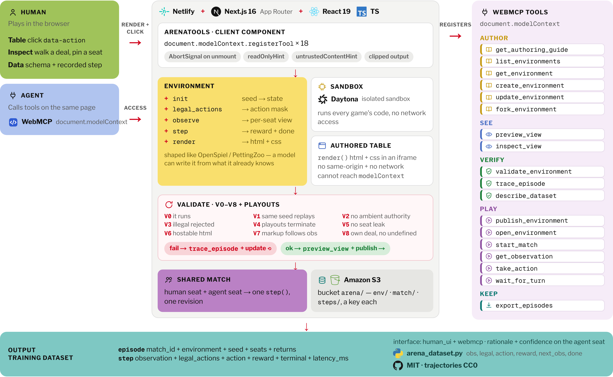

# Arena

An agent writes a turn-based game as five JavaScript functions, checks it, and plays it against a
person on the same page. The agent works through **WebMCP** tools the page registers on
`document.modelContext`. Every line of the game code it writes runs in a **Daytona** sandbox with
no network, never in the web server.



## Why this shape

An agent that writes code you then execute is writing untrusted code. Arena takes that seriously
at both ends:

- **The agent acts through tools, not through the UI.** Eighteen WebMCP tools cover authoring,
  checking, looking at the rendered table, publishing and playing. Each one returns enough state for
  the agent to decide its next step, and each one that hands back text written by a game is marked
  as untrusted content.
- **Its code runs somewhere it cannot hurt anything.** `init`, `legal_actions`, `observe`, `step`
  and `render` execute inside a Daytona sandbox created with all outbound network blocked. The
  sandbox holds no credentials. The web server only sends it source and arguments and reads back
  JSON.
- **Nothing is published on trust.** Nine checks (V0–V8) and a playout sweep run in that same
  sandbox before a game can be shared, and their failures come back as text an agent can act on.

## Run

```bash
npm install
cp .env.example .env.local     # add your Daytona API key
npm run dev
```

Open http://localhost:3000 in a browser with WebMCP enabled and ask your agent to design a game. It
writes the rules and the table both. The guide gives it the contract and the sandbox rules and
nothing else: no palette, no worked example, no catalogue to copy from. Nothing ships with the page;
every game on it was written there.

## How the Daytona runtime works

`src/lib/sandbox.ts` owns the only path from the app to environment code.

1. On first use it finds the sandbox labelled `app=arena-runtime`, starting it if it was stopped, or
   creates it with `networkBlockAll: true`, a 60-minute auto-stop and a one-day auto-archive.
2. It uploads a small Node server (`src/lib/runtime-source.ts`) and starts it in a Daytona session.
3. The app talks to it through the sandbox's private preview URL, authenticated with the sandbox's
   preview token. The token stays on the server.
4. Each call sends the environment's source, an entry point and a JSON argument. The server
   evaluates the source in a `vm` context of its own, with string code generation switched off, a
   wall-clock budget per call, and `Date`, `Math.random`, `fetch`, `process` and `require` removed.
   It answers with the result and how long the call ran.
5. If the runtime stops answering, the next call boots it again. A new runtime version restarts the
   server inside the same sandbox rather than creating another one.

A `vm` context only keeps one game away from another. The security boundary is the sandbox: code
that escaped its context would find itself on a machine with no network route out and no secrets to
read. `npm run check:runtime` tries exactly that.

Validation reports which sandbox ran the checks (`V2: Ran in Daytona sandbox …`), and timing uses
the run time measured inside the sandbox, so network latency is never mistaken for an expensive
`step()`.

## The environment contract

```js
init(seed)                   -> state
legal_actions(state, player) -> string[]
observe(state, player)       -> observation
step(state, action)          -> { state, rewards, terminal }
render(observation)          -> { html, css }
```

Functions are pure. `Date`, `Math.random` and I/O are unavailable. Use the injected `rng(n)` if the
game needs chance, and keep a `rng_cursor` on the state.

`render` returns HTML and CSS. Clickable nodes use `data-action` matching a legal action id. The
page hosts that markup in an iframe with no same-origin access and no network reach, so authored
markup cannot touch the page, its storage, or the tool surface.

## WebMCP tools

All eighteen are registered from one client component, `src/components/ArenaTools.tsx`, which
`src/app/layout.tsx` mounts on every page so the surface is there wherever the person is:

```ts
const model = document.modelContext ?? navigator.modelContext;

model.registerTool(
  {
    name: "create_environment",
    title: "Create a new game",
    description:
      "Create an environment. code may be partial — send the functions you have and build up. " +
      "Validation runs immediately and comes back with the result.",
    inputSchema: { /* ... */ },
    annotations: { /* ... */ },
    execute: async (input, run) => { /* ... */ },
  },
  { signal },
);
```

The second argument carries an `AbortSignal`, which is the only way to withdraw a tool.

| Tool | What it does |
| --- | --- |
| `get_authoring_guide` | Contract, sandbox rules, HTML/CSS render rules, the preview loop |
| `preview_view` | Draw markup, or a saved `render()` at any position, and describe what painted |
| `inspect_view` | Describe the live table the person is playing on |
| `list_environments` | What exists on the page, with validation state |
| `get_environment` | Spec and source, optionally one function |
| `create_environment` | New draft; validation runs immediately, in Daytona |
| `fork_environment` | Copy a validated environment |
| `update_environment` | Patch one function |
| `validate_environment` | V0–V8 plus playouts, as repair text |
| `trace_episode` | Step through a deal and watch state, legal actions, observation, rewards |
| `describe_dataset` | Trajectory schema and a sample row |
| `publish_environment` | Shareable `/e/{id}` if checks pass |
| `open_environment` | Put an environment's table on the person's screen |
| `start_match` | Deal a match on that table and take the opposite seat |
| `get_observation` | That seat's view and legal actions |
| `take_action` | Play a legal action |
| `wait_for_turn` | Rejoin a match by holding the call open until the person has moved |
| `export_episodes` | What was recorded, plus a download link |

The person and the agent share one page, so a tool that writes reloads the gallery and repaints the
table before it answers.

## Looking at the table

An agent cannot tell whether a board is right by reading its own HTML, so `preview_view` and
`inspect_view` describe what actually painted: repeated same-size boxes collapse into a character
grid with their real colours, everything else becomes positioned text, and every control is listed
with its size and whether it is enabled.

```
grid 7 cols x 6 rows, cell 40x40px:
  . . . . . . .
  . . . . . . .
  . . . . . . .
  . . . . . . .
  . . . A . . .
  . . B A B . .
  legend: .=#14392c x38  A=#f3d37a x2  B=#fffaf0 x2
```

The **Inspect** tab of any game walks it without starting a match: play a line forward, step back,
deal a different seed, and read the observation each seat was handed beside the board it produced.
Pinning a seat shows what that side can see while the other moves.

## Checks

Publishing runs V0–V8 in the Daytona sandbox: the code runs, the same seed replays, there is no
ambient authority, illegal actions are rejected, random playouts terminate, `observe` does not leak
another seat's private fields, `render` returns hostable HTML, changing an observation field changes
the markup, and every seat can see its own deal without `undefined` in it.

## Dataset

Each match is an `episode` header plus `step` rows:

```
observation, legal_actions, action, reward, terminal, latency_ms
```

Download from the play panel or `GET /api/episodes?match_id=…&format=jsonl`. `arena_dataset.py`
reads them from Python.

## Layout

```
src/
├── app/                      gallery, /e/[id] table, inspect, data, and the API routes
├── components/ArenaTools.tsx the WebMCP tool surface
└── lib/
    ├── sandbox.ts            the Daytona runtime client: find or create, boot, call
    ├── runtime-source.ts     the server that runs inside the sandbox
    ├── validate.ts           V0–V8 and the playout sweep
    ├── match-service.ts      one step(), one revision, one tape
    ├── store.ts              one key per game, match and tape
    ├── object-store.ts       the Amazon S3 bucket those keys live in
    └── guide.ts              what an author is told, and nothing beyond it
scripts/                      smoke checks, run with npm run check:*
```

## Checking it yourself

```bash
npm run check:runtime   # hostile game code in the Daytona sandbox: no network, no secrets
npm run check:create    # a draft saves quickly, and saving twice means once
npm run check:play      # a human click and an agent move in one match
npm run check:sandbox   # markup that escapes the sanitizer stays inside its frame
npm run check:tools     # every WebMCP tool is registered and within the naming budgets
```

The browser checks launch Playwright with `--enable-features=WebMCPTesting`. WebMCP is gated to
secure contexts, so use `http://localhost` rather than a file or a raw IP.

## Deploy

`netlify.toml` builds the app with the Next.js runtime plugin. Set these in the site's environment:

- `DAYTONA_API_KEY` (and `DAYTONA_API_URL` / `DAYTONA_TARGET` if you use them)
- `ARENA_S3_BUCKET`, `ARENA_S3_REGION`, `ARENA_S3_ACCESS_KEY_ID`, `ARENA_S3_SECRET_ACCESS_KEY` for
  the bucket games, matches and tapes are kept in, one object per key under `arena/`. The key
  needs `s3:GetObject`, `s3:PutObject`, `s3:DeleteObject` on the objects and `s3:ListBucket` on
  the bucket, nothing more.

Locally everything is kept in `.data/store.json`. `ARENA_STORE=s3` uses the bucket instead; set
`ARENA_S3_PREFIX` as well so local runs stay clear of the live games.

## License

MIT. Recorded trajectories are intended to be used as training data (CC0).
